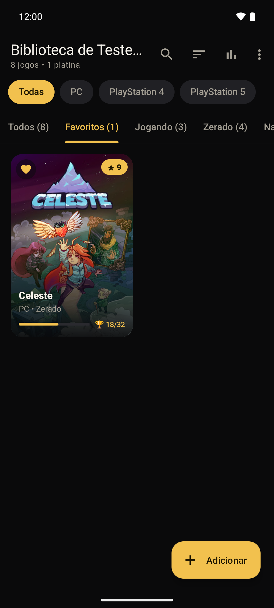
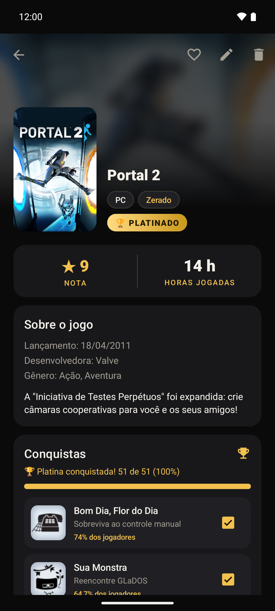
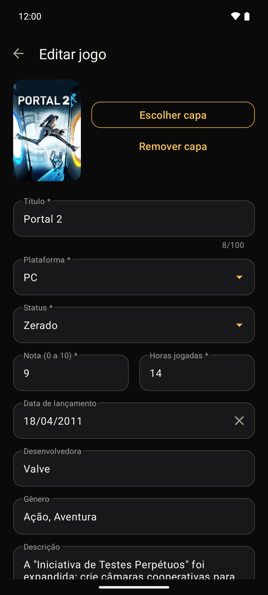
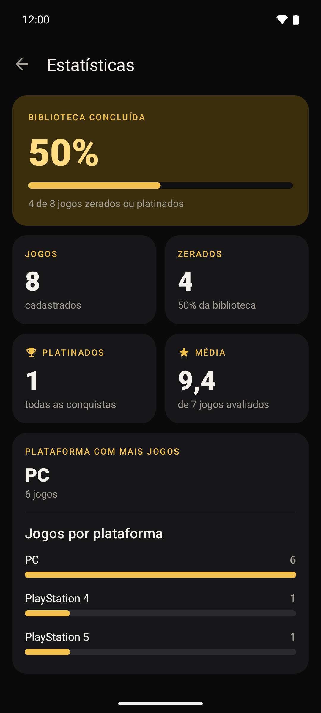
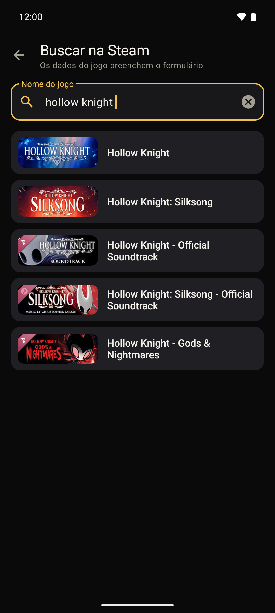
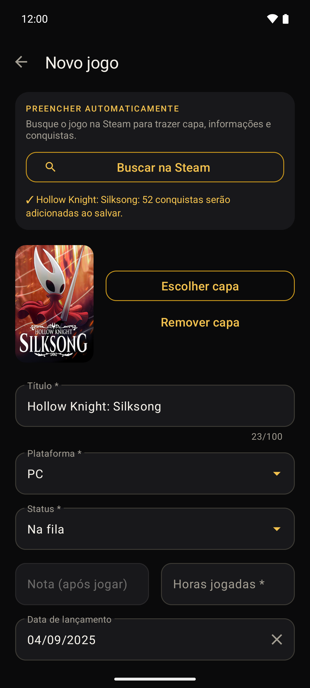
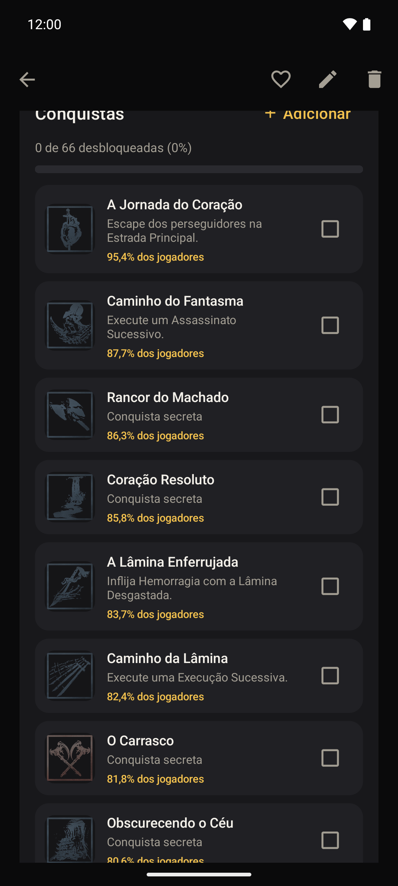
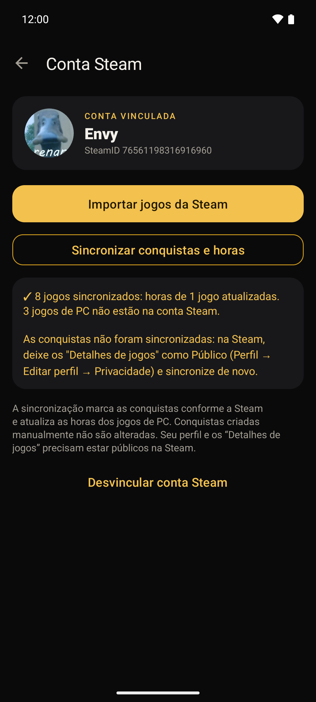
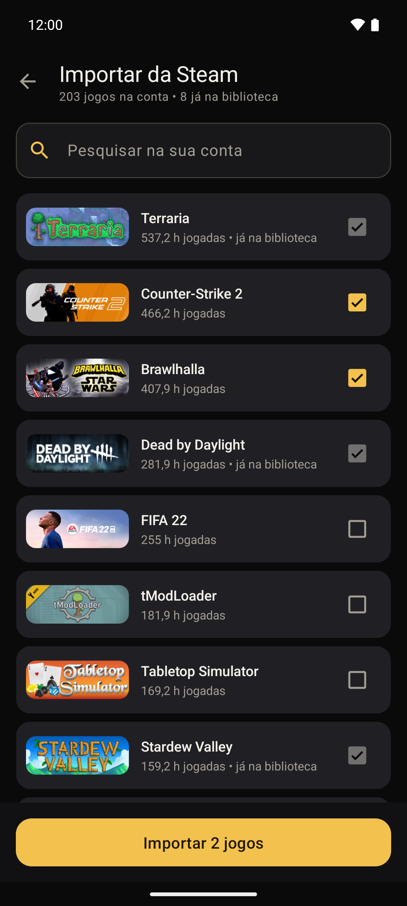

# Pixel Shelf (Catálogo de Jogos)

Projeto final da disciplina de **Desenvolvimento Mobile II** (UPF), desenvolvido em Kotlin com Android Studio.

## Integrantes
- Renan Vinciguerra Mentz — 198321
- Samuel Vitor Zibetti — 200388

## Descrição da proposta
Aplicativo Android para catalogar a coleção de jogos. Cada jogo guarda título, plataforma,
status (**Jogando**, **Zerado** ou **Na fila**), nota (0 a 10), horas jogadas, capa, data de
lançamento, desenvolvedora, gênero, descrição e uma lista de conquistas que podem ser marcadas
como obtidas.

### Funcionalidades
- **Contas de usuário**: cadastro, login por e-mail e senha, opção "Manter conectado" e sair da conta
- **Biblioteca por usuário**: cada conta tem os próprios jogos; uma conta nova começa vazia
- **CRUD de jogos**: cadastrar, listar, editar e excluir
- **Busca na Steam (Retrofit)**: no cadastro de jogo, busque pelo nome e escolha o resultado; capa,
  data de lançamento, desenvolvedora, gênero e descrição (em português) são preenchidos sozinhos e,
  com a chave da Steam configurada, todas as conquistas do jogo são importadas com a raridade
- **Conta Steam vinculada**: o usuário cola o link do perfil Steam (sem senha) e pode
  **importar os jogos da conta** (com as horas jogadas) e **sincronizar as conquistas**: as que
  ele já desbloqueou na Steam ficam marcadas e a platina aparece sozinha
- Biblioteca em grade com capas, nota e progresso de conquistas
- **Abas** (Todos, Favoritos, Jogando, Zerado, Na fila), cada uma um `Fragment`, com a quantidade de jogos
- Pesquisa por nome, filtro por plataforma e ordenação (nome ou maior nota)
- Conquistas por jogo, com barra de progresso; também dá para **adicionar conquistas
  manualmente** e excluí-las (segurando a conquista)
- **Platina**: ao desbloquear todas as conquistas de um jogo ele ganha o selo de platina
  (destaque dourado na biblioteca e no detalhe, com mensagem de parabéns)
- **Favoritos**: marcar/desmarcar jogos favoritos pelo coração na tela de detalhes
- **Estatísticas pessoais**: total de jogos, zerados, platinados, média das notas, plataforma
  com mais jogos (com gráfico de jogos por plataforma) e percentual da biblioteca concluída

### Validações e regras de negócio
- Cadastro: nome obrigatório, e-mail válido e único, senha com no mínimo 6 caracteres e confirmação igual
- Senhas nunca são guardadas em texto: o Room guarda só o hash (PBKDF2) com salt aleatório
- Título, plataforma e status são obrigatórios; nota entre 0 e 10; horas maiores ou iguais a 0
- Jogo **Na fila** ainda não foi jogado, então não tem nota; **Jogando** pode ficar sem nota
  até ser avaliado; **Zerado** precisa de nota
- Jogo **Zerado** precisa ter horas jogadas
- Não é possível cadastrar o mesmo jogo duas vezes na mesma plataforma (na biblioteca do usuário)
- Conquista manual: nome obrigatório e sem repetir o nome de outra conquista do mesmo jogo
- Jogo importado da Steam entra como **PC**; status, nota e horas continuam sendo do usuário
- Conta Steam: aceita o link do perfil (`/id/nome` ou `/profiles/SteamID`), o SteamID ou o nome
  personalizado; a mesma conta Steam não pode ser vinculada a dois usuários do app
- Importação da conta: jogo com horas ou alguma conquista obtida entra como **Jogando** (sem nota),
  senão como **Na fila**;
  jogo que já está na biblioteca não é importado de novo
- Sincronização: liga cada jogo de PC ao jogo da conta (pelo id da Steam ou pelo nome), marca e
  desmarca as conquistas conforme a Steam e só aumenta as horas (nunca diminui o que o usuário
  registrou); conquistas criadas manualmente não são alteradas
- Platina = todas as conquistas obtidas (jogo sem conquistas não tem platina); é calculada, não
  fica gravada no banco
- Estatísticas: a média das notas ignora jogos sem nota (Na fila) e um jogo conta como
  concluído quando está Zerado ou platinado; empates na plataforma com mais jogos aparecem juntos

## Tecnologias utilizadas
- Kotlin e Android Studio (Views XML + ViewBinding)
- Activities e Fragments (`ViewPager2` + `TabLayout`)
- Room (SQLite) com três entidades (`Game`, `Conquista` e `Usuario`), banco na versão 6 com
  migrações entre todas as versões (sem perder dados ao atualizar o app). Na versão 5 cada jogo
  ganhou dono (`usuarioId`); jogos de versões anteriores ficam com a primeira conta que
  entrar depois da atualização. Na versão 6, o usuário ganhou o SteamID da conta vinculada
  (único) e o jogo, o id dele na Steam
- Retrofit + Gson para consumir a API da loja Steam (busca e detalhes) e a Steam Web API
  (conquistas, percentual global de jogadores, perfil, jogos da conta e progresso do jogador); os ícones das conquistas são convertidos para o endereço atual da CDN
  da Steam (a API ainda devolve um domínio antigo, que não responde mais)
- `SharedPreferences` para a sessão do usuário e hash de senha com PBKDF2 (`javax.crypto`)
- `ViewModel`, Coroutines e Flow
- Material Components
- Coil (carregamento das capas pela internet)
- Git e GitHub (branches e Pull Requests)

## Estrutura do projeto
```
app/src/main/java/com/pixelshelf/
├── data/   Game, Conquista, Usuario, Estatisticas, DAOs, AppDatabase, AuthRepository,
│   │       Senhas, SessaoUsuario, SincronizacaoSteam
│   └── steam/  SteamApi (interfaces Retrofit e DTOs), SteamRepository, ContaSteamRepository
└── ui/     LoginActivity, RegisterActivity, MainActivity, GameFormActivity, GameDetailActivity,
            EstatisticasActivity, BuscaSteamActivity, ContaSteamActivity,
            ImportarJogosSteamActivity, GameListFragment, StatusPagerAdapter, MainViewModel,
            GameFormViewModel, ContaSteamViewModel, ImportarJogosViewModel, adapters
```

### Telas (Activities)
| Activity | Função |
|---|---|
| `LoginActivity` | Entrada no app (e-mail e senha, "Manter conectado") |
| `RegisterActivity` | Cadastro de conta |
| `MainActivity` | Biblioteca com abas (`GameListFragment`), pesquisa, filtro e ordenação |
| `GameFormActivity` | Cadastro e edição de jogo, com validações e importação da Steam |
| `BuscaSteamActivity` | Busca de jogos na Steam pelo nome (Retrofit) |
| `GameDetailActivity` | Detalhes, conquistas (marcar, adicionar e excluir), platina, favorito e exclusão |
| `EstatisticasActivity` | Estatísticas pessoais da biblioteca |
| `ContaSteamActivity` | Vincular/desvincular a conta Steam e sincronizar conquistas e horas |
| `ImportarJogosSteamActivity` | Lista os jogos da conta Steam para escolher quais importar |

## Ciclo de vida dos componentes
- `MainActivity` e `GameListFragment` registram no Logcat cada callback do ciclo de vida
  (`onCreate`, `onStart`, `onResume`, `onPause`, `onStop`, `onDestroy`; no fragment também
  `onAttach`, `onCreateView`, `onViewCreated` e `onDestroyView`). Para ver, filtre o Logcat por
  `PixelShelf-Ciclo`.
- Os Flows do Room são coletados com `repeatOnLifecycle(STARTED)`: a tela só observa o banco
  enquanto está visível.
- No `Fragment`, a coleta usa o `viewLifecycleOwner` e o `binding` é anulado em `onDestroyView`,
  evitando vazamento de memória.
- O estado da biblioteca (pesquisa, plataforma e ordenação) fica em um `ViewModel` compartilhado
  entre a Activity e os Fragments, então sobrevive à rotação da tela.
- No cadastro de jogo, a importação da Steam fica no `GameFormViewModel`: girar a tela durante a
  requisição não a cancela, e as conquistas importadas continuam guardadas até salvar.
- A vinculação, a sincronização e a importação dos jogos da conta também rodam em ViewModels
  (`ContaSteamViewModel` e `ImportarJogosViewModel`): a importação de vários jogos continua se a
  tela girar, e os eventos (mensagens, resultado) são entregues uma única vez por `Channel`.

## Instruções de execução
1. Clonar: `git clone https://github.com/RenanMentz/pixel_shelf.git`
2. Abrir a pasta no Android Studio e aguardar o *Gradle Sync* (usar JDK 17 ou 21 em
   *Settings → Build Tools → Gradle → Gradle JDK*).
3. Executar (`Run ▶`) em um emulador ou dispositivo com Android 7.0 (API 24) ou superior.
   É necessário ter internet para carregar as capas e os ícones das conquistas.
4. Na primeira execução, toque em **Criar conta**, cadastre-se e o app entra automaticamente.
   Nas próximas vezes, entre com e-mail e senha (ou fica conectado, se a opção estiver marcada).
5. A biblioteca começa vazia: toque em **Adicionar → Buscar na Steam** para importar um jogo.

### Chave da Steam (opcional, para importar as conquistas)
A busca e os dados do jogo funcionam sem configurar nada. Para importar também as conquistas:
1. Gere uma chave em <https://steamcommunity.com/dev/apikey> (precisa de uma conta Steam).
2. Adicione esta linha ao arquivo `local.properties`, na raiz do projeto:
   ```
   steam.apiKey=SUA_CHAVE_AQUI
   ```
3. Faça o *Gradle Sync* e rode o app de novo.

O `local.properties` não vai para o Git, então a chave não fica pública. Sem a chave, o jogo é
importado sem conquistas e elas podem ser adicionadas manualmente na tela de detalhes.

### Vincular a conta Steam (precisa da chave)
1. Na biblioteca, abra o menu **⋮ → Conta Steam**.
2. Cole o link do seu perfil (ex.: `steamcommunity.com/id/seunome`) e toque em **Vincular**.
3. Use **Importar jogos da Steam** para trazer jogos da conta e **Sincronizar conquistas e
   horas** para atualizar os que já estão na biblioteca.

Na Steam, o perfil e os **Detalhes de jogos** precisam estar como *Público*
(Perfil → Editar perfil → Privacidade); senão a Steam não informa jogos nem conquistas.

## Prints das telas
Os arquivos estão na pasta [`screenshots/`](screenshots/).

| Login | Cadastro | Biblioteca |
|---|---|---|
|  |  |  |

| Favoritos | Detalhes e platina | Edição de jogo |
|---|---|---|
|  |  |  |

| Estatísticas | Busca na Steam | Jogo importado da Steam |
|---|---|---|
|  |  |  |

| Conquistas importadas (com raridade) | Conta Steam vinculada | Importar jogos da conta |
|---|---|---|
|  |  |  |
