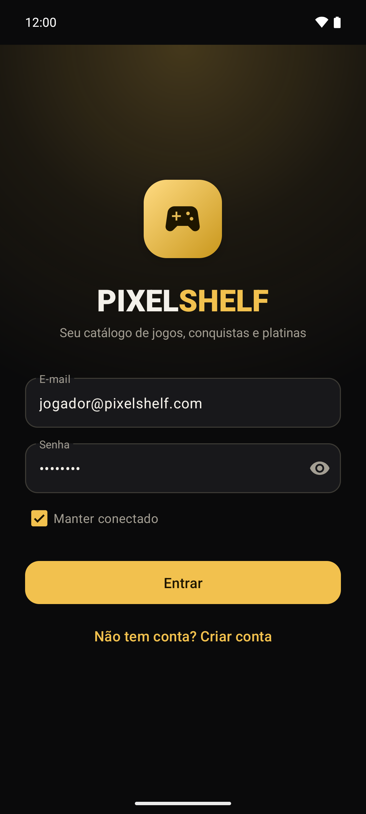
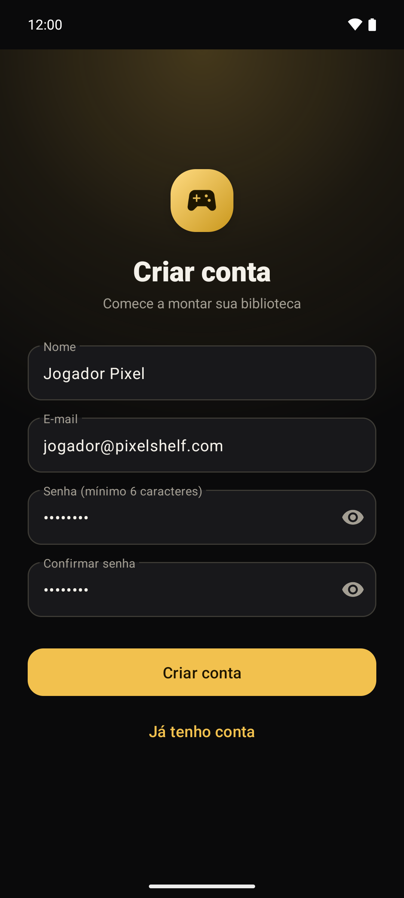
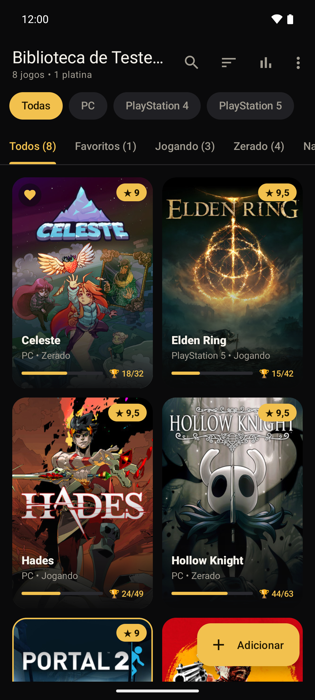

# Pixel Shelf (Catálogo de Jogos)

Projeto final da disciplina de **Desenvolvimento Mobile II** (UPF), desenvolvido em Kotlin com Android Studio.

## Integrantes
- Renan Vinciguerra Mentz — 198321
- Samuel Vitor Zibetti — 200388

## Descrição da proposta
Aplicativo Android para catalogar a coleção de jogos. Cada jogo guarda título, plataforma,
status (**Jogando**, **Zerado** ou **Na fila**), nota (0 a 10), horas jogadas, capa, data de
lançamento, desenvolvedora, gênero, descrição e uma lista de conquistas que podem ser marcadas
como obtidas.

### Funcionalidades
- **Contas de usuário**: cadastro, login por e-mail e senha, opção "Manter conectado" e sair da conta
- **CRUD de jogos**: cadastrar, listar, editar e excluir
- Biblioteca em grade com capas, nota e progresso de conquistas
- **Abas** (Todos, Favoritos, Jogando, Zerado, Na fila), cada uma um `Fragment`, com a quantidade de jogos
- Pesquisa por nome, filtro por plataforma e ordenação (nome ou maior nota)
- Conquistas por jogo, com barra de progresso
- **Platina**: ao desbloquear todas as conquistas de um jogo ele ganha o selo de platina
  (destaque dourado na biblioteca e no detalhe, com mensagem de parabéns)
- **Favoritos**: marcar/desmarcar jogos favoritos pelo coração na tela de detalhes
- **Estatísticas pessoais**: total de jogos, zerados, platinados, média das notas, plataforma
  com mais jogos (com gráfico de jogos por plataforma) e percentual da biblioteca concluída
- Jogos de exemplo carregados na primeira execução (`assets/jogos_iniciais.json`)

### Validações e regras de negócio
- Cadastro: nome obrigatório, e-mail válido e único, senha com no mínimo 6 caracteres e confirmação igual
- Senhas nunca são guardadas em texto: o Room guarda só o hash (PBKDF2) com salt aleatório
- Título, plataforma e status são obrigatórios; nota entre 0 e 10; horas maiores ou iguais a 0
- Jogo **Na fila** ainda não foi jogado, então não tem nota
- Jogo **Zerado** precisa ter horas jogadas
- Não é possível cadastrar o mesmo jogo duas vezes na mesma plataforma
- Platina = todas as conquistas obtidas (jogo sem conquistas não tem platina); é calculada, não
  fica gravada no banco
- Estatísticas: a média das notas ignora jogos sem nota (Na fila) e um jogo conta como
  concluído quando está Zerado ou platinado; empates na plataforma com mais jogos aparecem juntos

## Tecnologias utilizadas
- Kotlin e Android Studio (Views XML + ViewBinding)
- Activities e Fragments (`ViewPager2` + `TabLayout`)
- Room (SQLite) com três entidades (`Game`, `Conquista` e `Usuario`), banco na versão 4 com
  migrações entre todas as versões (sem perder dados ao atualizar o app)
- `SharedPreferences` para a sessão do usuário e hash de senha com PBKDF2 (`javax.crypto`)
- `ViewModel`, Coroutines e Flow
- Material Components
- Coil (carregamento das capas pela internet)
- Git e GitHub (branches e Pull Requests)

## Estrutura do projeto
```
app/src/main/java/com/pixelshelf/
├── data/   Game, Conquista, Usuario, Estatisticas, DAOs, AppDatabase, AuthRepository,
│           Senhas, SessaoUsuario, DadosIniciais
└── ui/     LoginActivity, RegisterActivity, MainActivity, GameFormActivity, GameDetailActivity,
            EstatisticasActivity, GameListFragment, StatusPagerAdapter, MainViewModel, adapters
```

### Telas (Activities)
| Activity | Função |
|---|---|
| `LoginActivity` | Entrada no app (e-mail e senha, "Manter conectado") |
| `RegisterActivity` | Cadastro de conta |
| `MainActivity` | Biblioteca com abas (`GameListFragment`), pesquisa, filtro e ordenação |
| `GameFormActivity` | Cadastro e edição de jogo, com validações |
| `GameDetailActivity` | Detalhes, conquistas, platina, favorito e exclusão |
| `EstatisticasActivity` | Estatísticas pessoais da biblioteca |

## Ciclo de vida dos componentes
- `MainActivity` e `GameListFragment` registram no Logcat cada callback do ciclo de vida
  (`onCreate`, `onStart`, `onResume`, `onPause`, `onStop`, `onDestroy`; no fragment também
  `onAttach`, `onCreateView`, `onViewCreated` e `onDestroyView`). Para ver, filtre o Logcat por
  `PixelShelf-Ciclo`.
- Os Flows do Room são coletados com `repeatOnLifecycle(STARTED)`: a tela só observa o banco
  enquanto está visível.
- No `Fragment`, a coleta usa o `viewLifecycleOwner` e o `binding` é anulado em `onDestroyView`,
  evitando vazamento de memória.
- O estado da biblioteca (pesquisa, plataforma e ordenação) fica em um `ViewModel` compartilhado
  entre a Activity e os Fragments, então sobrevive à rotação da tela.

## Instruções de execução
1. Clonar: `git clone https://github.com/RenanMentz/pixel_shelf.git`
2. Abrir a pasta no Android Studio e aguardar o *Gradle Sync* (usar JDK 17 ou 21 em
   *Settings → Build Tools → Gradle → Gradle JDK*).
3. Executar (`Run ▶`) em um emulador ou dispositivo com Android 7.0 (API 24) ou superior.
   É necessário ter internet para carregar as capas e os ícones das conquistas.
4. Na primeira execução, toque em **Criar conta**, cadastre-se e o app entra automaticamente.
   Nas próximas vezes, entre com e-mail e senha (ou fica conectado, se a opção estiver marcada).

## Prints das telas
Os arquivos estão na pasta [`screenshots/`](screenshots/).

| Login | Cadastro | Biblioteca |
|---|---|---|
|  |  |  |

| Favoritos | Detalhes e platina | Edição de jogo |
|---|---|---|
|  |  |  |

| Estatísticas |
|---|
|  |
